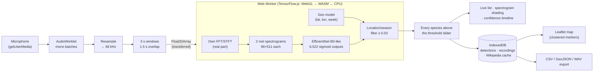

# Sabih’s Birdbrain

**Point your phone at the dawn chorus and see who is singing.** Sabih’s Birdbrain
is a progressive web app that identifies bird sounds in real time, entirely on
the device, using the BirdNET V2.4 neural network running in TensorFlow.js
inside a Web Worker. It records, re-analyses, explains its own identifications,
looks species up, maps where you heard them, and works offline once installed.

Live app: **https://sabihs-birdbrain.vercel.app**. API: `https://bird-brain.duckdns.org` (`server/`).

| Listen (light) | Listen (dark) | Species | Map |
| --- | --- | --- | --- |
|  |  |  |  |

| Recording analysed | “Why this ID” heatmap | Species search | Settings |
| --- | --- | --- | --- |
|  |  |  |  |

*Screenshots taken with Playwright at iPhone 13 size from the built app. The
species page shows the retry state because the build machine’s shared network
address was rate-limited by Wikipedia.*

## The problem

Bird-ID apps upload your audio to a server, need an account, or stop working
without signal. Good bioacoustic models exist and run fine on a phone, so the
interesting question was: how much of a complete field tool can be built as a
plain web page, with no backend and no data leaving the device, and can it also
*show* what the model is doing instead of just printing a name?

Constraints that shaped it:

- iOS Safari: the microphone needs HTTPS and a user gesture, web audio stops in
  the background, and storage can be evicted. The app is honest about all three.
- 78 MiB of model weights: downloaded once with a progress bar, then served from
  the browser cache.
- The BirdNET model is a Keras model with a custom spectrogram layer that has no
  TensorFlow.js implementation. It had to be re-implemented from the model’s own
  configuration and verified numerically.

## How it works



Every stage is visible in the app’s **How it works** panel, which lights up as
audio passes through, and in the live visualisation: a waveform, a scrolling
spectrogram drawn with the app’s own FFT (labelled as an approximation of the
model’s internal mel spectrograms), the sliding 3-second analysis window, colour
strips for the species found in each window, and a per-species confidence
timeline.

**Why this ID.** On a saved recording you can ask why the model thinks a window
contains, say, a House Finch. The app silences one time–frequency region at a
time, re-runs the model, and paints the regions whose removal hurt the
confidence most over the spectrogram in the species’ colour. It runs in the
worker with a progress bar and a cancel button; the grid is coarse by default
because each cell is a full model pass.

**Species colours.** Each species has a fixed colour derived from a hash of its
scientific name in OKLCH, chosen to read on both light and dark backgrounds.
The name is always shown next to the colour.

## Features

- **Listen:** Start/Stop continuous listening, multi-species results with
  confidences, confidence threshold slider, elapsed time, inference time,
  dropped-window count, screen wake lock (with a notice when unsupported),
  resume after returning to the foreground, a “Try the sample clip” demo,
  and a conditions indicator (Good / Too quiet / Windy, guidance only).
- **Microphone handling:** asks the browser for raw audio (echo cancellation,
  noise suppression and automatic gain off) and shows in Settings what was
  actually applied; a 150 Hz low-cut filter on the analysis path (default on)
  removes wind rumble from what the model hears while saved recordings stay
  unfiltered.
- **Location filter:** GPS plus BirdNET’s week-of-year (four per month) through
  the official geo model; manual coordinates or off when location is denied.
  The strongest filtered-out species is shown greyed so the filter is visible.
- **Recordings:** record WAV straight from the AudioWorklet stream (no
  MediaRecorder), import audio files, play back, re-analyse with full
  visualisation and seek-by-tap, export WAV, delete, optional auto-save of a
  3 s clip per detection.
- **Location sharing:** every located detection shows coordinates and a
  10-character Plus Code with copy buttons and an "Open in Google Maps" link.
- **Accounts (optional):** email + password + emailed code; approved members
  can ask AI questions about a species, answered only from its Wikipedia
  summary; Sabih approves members on an admin page.
- **Species:** offline browser of all 6,522 BirdNET classes with search by
  common or scientific name; Wikipedia summary (scientific name first, then
  common; disambiguation and not-found handled), image with Commons attribution
  link, cached for offline; your own detection count, first/last seen, mini map
  and links to recordings. Tapping a species anywhere opens its page.
- **Map:** OpenStreetMap with markers in species colours, clustering, species
  and date filters, tap a marker to open the species page. Attribution shown;
  tiles are never cached or prefetched.
- **Settings:** threshold, overlap, location source and manual coordinates,
  seasonal filter, species-range threshold, auto-save, compute backend,
  occlusion resolution, storage used vs available, `navigator.storage.persist()`
  result, CSV and GeoJSON export, delete all.
- **PWA:** manifest, icons, apple-touch-icon, service worker precaching the app
  shell and label list, cache-first model files, offline operation.

## Privacy

Audio is processed on the device and never uploaded: identification, saving
recordings and analysing imported clips (capped at 60 seconds) all happen in
your browser, for everyone, signed in or not. Recordings and detections live in
your browser's IndexedDB; you can export or delete them at any time.

What does leave the phone, and why:

- The one-time model download from the hosting origin, Wikipedia summaries
  when you open a species page, and OpenStreetMap tiles when you open the map.
- If you create an account (optional): your email address and password go to
  the Birdbrain API at `bird-brain.duckdns.org`, which emails you a 6-digit
  code on every sign-in and keeps a short-lived session token (the API only
  accepts requests from `https://sabihs-birdbrain.vercel.app`). New accounts
  wait for Sabih's approval.
- If you are an approved member and use "Ask about this bird": only the
  species' scientific name and your question (up to 500 characters) are sent.
  The server fetches the Wikipedia summary and asks Google's Gemini model to
  answer from that text alone; the answer comes back as plain text with the
  source link. Questions are not logged. There are daily limits per person and
  overall.

No analytics, no ads, no third-party trackers. The API's design and its review
against the OWASP LLM Top 10 and ASVS are in [docs/SECURITY.md](docs/SECURITY.md).

## Known limitations

- **No background listening.** iOS stops web audio when the screen locks or you
  switch apps. The app keeps the screen awake while listening (Wake Lock API)
  and tells you when it cannot.
- **No separation of overlapping calls.** BirdNET marks *when* each species is
  present in a 3-second window. It does not separate overlapping calls, count
  individuals or attribute sounds to birds.
- **iOS quirks.** The microphone needs HTTPS and a tap; the home-screen app may
  ask for permission again; Safari can delete site data that has not been used
  for a while even after persistent storage is granted (export what you care
  about); WebGL inside a Web Worker is worked around on Safari and falls back to
  WebAssembly, which is slower.
- **Accuracy.** Confidence is a model score, not a probability of being right.
  Expect confusions between similar species, false positives from mimics and
  noise, and misses for distant or faint birds. Treat results as prompts to
  verify, not records.
- **Speed.** The model is 0.83 GFLOPs per window. On a GPU-backed browser a
  window takes well under a second; on the WebAssembly fallback it can take
  several seconds, and windows that arrive while inference is busy are skipped
  (the count is shown).

## V2: a native iOS app

The web app proves the pipeline but cannot listen in the background. V2 is a
Swift/SwiftUI app with AVAudioEngine capture, the `audio` background mode, and
BirdNET on Core ML or TensorFlow Lite using the Neural Engine, which should be
roughly an order of magnitude faster and far lighter on the battery. It will
keep the same data model and import the PWA’s CSV/GeoJSON exports, use MapKit
instead of Leaflet, and share the species-colour and week-of-year functions so
both apps agree.

## Development

```
npm install
npm run dev            # http://localhost:5173/
npm run lint && npm run typecheck && npm test
npm run build          # typecheck + vite build → dist/
npm run preview        # serve the build at http://localhost:4173/
npm run test:e2e       # Playwright: loads the model, analyses the bundled sample, goes offline
cd server && npm install && npm test   # API unit + integration tests (fake mailer, in-memory SQLite)
```

Front-end build settings live in `.env.example` (`VITE_API_BASE_URL`,
`VITE_BASE_PATH`). The API is in `server/` with its own `README`-style notes in
`server/deploy/README.md`, `server/.env.example` (variable names only) and
`docs/SECURITY.md`.

Unit tests (Vitest) cover the FFT/STFT, resampling and windowing, threshold and
multi-label logic, the week-of-year calculation, species colours, WAV encoding
and decoding, occlusion masking, and CSV/GeoJSON export. The Playwright test
runs the built app in Chromium at iPhone size, waits for the models to load in
the worker, identifies the sample clip that ships with the official BirdNET
TF.js export (a redpoll), checks the WebAssembly fallback, then reloads offline
and does it again from the caches. GitHub Actions runs all of it on every push;
Vercel builds and deploys the front end from `main`.

Architecture notes for contributors are in [CLAUDE.md](CLAUDE.md); the build
decisions and their alternatives are in [DECISIONS.md](DECISIONS.md); sources,
versions and licences of everything third-party are in
[docs/SOURCES.md](docs/SOURCES.md).

## Licensing and credits

- **Application code:** MIT (see [LICENSE](LICENSE)).
- **BirdNET models** (`public/models/birdnet-v2.4/`, acoustic and
  location/season models, label list, and the sample clip): © the BirdNET team,
  Stefan Kahl et al., K. Lisa Yang Center for Conservation Bioacoustics at the
  Cornell Lab of Ornithology and Chemnitz University of Technology, licensed
  **CC BY-NC-SA 4.0**, non-commercial use only. They are not covered by the MIT
  licence. Taken from the official TensorFlow.js export in the
  [BirdNET-Analyzer](https://github.com/birdnet-team/BirdNET-Analyzer)
  repository (tag v1.5.1). Citation: Kahl, S., Wood, C. M., Eibl, M., & Klinck,
  H. (2021). *BirdNET: A deep learning solution for avian diversity monitoring.*
  Ecological Informatics, 61, 101236.
- **Map data:** © [OpenStreetMap](https://www.openstreetmap.org/copyright)
  contributors (ODbL), tiles from the OSM tile servers under their usage policy.
- **Species text:** Wikipedia, CC BY-SA 4.0. **Images:** Wikimedia Commons,
  each under its own licence, linked from every image.
- TensorFlow.js (Apache-2.0), Leaflet (BSD-2-Clause), Leaflet.markercluster
  (MIT), idb (ISC).
